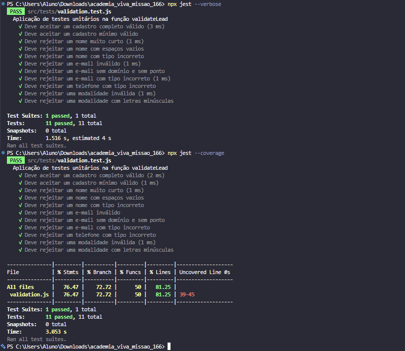

# RELATÓRIO DE TESTES DE SOFTWARE

## 1. Identificação do projeto

| Informação | Descrição |
| --- | --- |
| **Nome do projeto:** | Academia Viva |
| **Resumo do projeto:** | [O que é a aplicação] |
| **Nome do testador:** | [Frederico Souza Martins] |
| **Data dos testes:** | 05/11/2026 |
| **Tecnologias utilizadas:** | JavaScript, Node.js, Jest, NPM |

---

## 2. Objetivo dos testes

Os testes unitários tiveram como objetivo verificar o funcionamento da função `validateLead`, responsável por validar os dados de cadastro de um lead (nome, e-mail, telefone e modalidade de interesse).

Os testes pretendiam verificar se a função:

- aceita cadastros válidos, tanto completos quanto mínimos (apenas nome e e-mail);
- rejeita nomes curtos, vazios (apenas espaços) ou que não sejam texto;
- rejeita e-mails em formato inválido ou que não sejam texto;
- rejeita telefones que não sejam texto;
- rejeita modalidades inexistentes e diferencia letras maiúsculas de minúsculas.

Os possíveis erros a identificar eram: aceitação de dados inválidos, rejeição de dados válidos, mensagens de erro incorretas e falhas no tratamento de tipos de dados inesperados.

---

## 3. Ambiente de testes

| Ferramenta/Tecnologia | Versão |
| --- | --- |
| JavaScript | ECMAScript (executado no Node.js) |
| Node.js | v22.2.0 |
| Jest | 30.5.2 |
| NPM | 10.7.0 |
| Outras | Visual Studio Code (editor) |

**Comando utilizado para preparar o ambiente:**

```bash
npm install
```

**Comando utilizado para executar o sistema (servidor):**

```bash
[escreva o comando do servidor, ex.: npm start]
```

**Comando utilizado para executar os testes:**

```bash
npx jest --verbose
```

---

## 4. Funcionalidades testadas

| Nº | Funcionalidade/Função | Arquivo | Objetivo do teste |
| --- | --- | --- | --- |
| 1 | `validateLead` (campo `name`) | src/validation.js | Verificar que o nome é texto com no mínimo 3 caracteres (sem contar espaços vazios) |
| 2 | `validateLead` (campo `email`) | src/validation.js | Verificar que o e-mail é texto e possui formato válido, com domínio completo |
| 3 | `validateLead` (campo `phone`) | src/validation.js | Verificar que o telefone, quando informado, é um texto |
| 4 | `validateLead` (campo `interest`) | src/validation.js | Verificar que a modalidade, quando informada, é um valor válido (ex.: "Online") |

---

## 5. Registro detalhado dos testes realizados

### Teste 01 – Cadastro completo válido

- **Funcionalidade testada:** `validateLead`
- **Arquivo do teste:** src/tests/validation.test.js
- **Nome do teste no Jest:** Deve aceitar um cadastro completo válido
- **Objetivo:** Verificar se um cadastro com todos os campos válidos é aceito
- **Tipo de cenário:** Positivo
- **Entrada utilizada:** `{ name: "João da Silva", email: "joao@gmail.com", phone: "1234567890", interest: "Online" }`
- **Resultado esperado:** `valid` igual a `true` e nenhum erro na lista `errors`
- **Resultado obtido:** Igual ao esperado: `valid` igual a `true` e `errors` vazio
- **Status:** Aprovado

**Código do teste:**

```javascript
test("Deve aceitar um cadastro completo válido", () => {
  const resultado = validateLead({
    name: "João da Silva",
    email: "joao@gmail.com",
    phone: "1234567890",
    interest: "Online"
  });

  expect(resultado.valid).toBe(true);
  expect(resultado.errors.length).toBe(0);
});
```

---

### Teste 02 – Cadastro mínimo válido

- **Funcionalidade testada:** `validateLead`
- **Arquivo do teste:** src/tests/validation.test.js
- **Nome do teste no Jest:** Deve aceitar um cadastro mínimo válido
- **Objetivo:** Verificar se os campos opcionais (telefone e modalidade) podem ser omitidos
- **Tipo de cenário:** Positivo / Limite
- **Entrada utilizada:** `{ name: "Ana", email: "ana@gmail.com" }`
- **Resultado esperado:** `valid` igual a `true` e nenhum erro
- **Resultado obtido:** Igual ao esperado: `valid` igual a `true` e `errors` vazio
- **Status:** Aprovado

**Código do teste:**

```javascript
test("Deve aceitar um cadastro mínimo válido", () => {
  const resultado = validateLead({
    name: "Ana",
    email: "ana@gmail.com"
  });

  expect(resultado.valid).toBe(true);
  expect(resultado.errors.length).toBe(0);
});
```

---

### Teste 03 – Nome muito curto

- **Funcionalidade testada:** `validateLead` (campo `name`)
- **Arquivo do teste:** src/tests/validation.test.js
- **Nome do teste no Jest:** Deve rejeitar um nome muito curto
- **Objetivo:** Verificar se nomes com menos de 3 caracteres são rejeitados
- **Tipo de cenário:** Negativo / Limite
- **Entrada utilizada:** `{ name: "Jo", email: "ana@gmail.com" }`
- **Resultado esperado:** `valid` igual a `false` e erro "Informe seu nome (mínimo de 3 caracteres)."
- **Resultado obtido:** Igual ao esperado: `valid` igual a `false` e erro "Informe seu nome (mínimo de 3 caracteres)."
- **Status:** Aprovado

**Código do teste:**

```javascript
test("Deve rejeitar um nome muito curto", () => {
  const resultado = validateLead({
    name: "Jo",
    email: "ana@gmail.com"
  });

  expect(resultado.valid).toBe(false);
  expect(resultado.errors).toContain(
    "Informe seu nome (mínimo de 3 caracteres)."
  );
});
```

---

### Teste 04 – Nome com espaços vazios

- **Funcionalidade testada:** `validateLead` (campo `name`)
- **Arquivo do teste:** src/tests/validation.test.js
- **Nome do teste no Jest:** Deve rejeitar um nome com espaços vazios
- **Objetivo:** Verificar se um nome composto apenas por espaços é rejeitado
- **Tipo de cenário:** Negativo
- **Entrada utilizada:** `{ name: "   ", email: "ana@gmail.com" }`
- **Resultado esperado:** `valid` igual a `false` e erro "Informe seu nome (mínimo de 3 caracteres)."
- **Resultado obtido:** Igual ao esperado: `valid` igual a `false` e erro "Informe seu nome (mínimo de 3 caracteres)."
- **Status:** Aprovado

**Código do teste:**

```javascript
test("Deve rejeitar um nome com espaços vazios", () => {
  const resultado = validateLead({
    name: "   ",
    email: "ana@gmail.com"
  });

  expect(resultado.valid).toBe(false);
  expect(resultado.errors).toContain(
    "Informe seu nome (mínimo de 3 caracteres)."
  );
});
```

---

### Teste 05 – Nome com tipo incorreto

- **Funcionalidade testada:** `validateLead` (campo `name`)
- **Arquivo do teste:** src/tests/validation.test.js
- **Nome do teste no Jest:** Deve rejeitar um nome com tipo incorreto
- **Objetivo:** Verificar se um nome que não seja texto é rejeitado
- **Tipo de cenário:** Excepcional
- **Entrada utilizada:** `{ name: 123, email: "ana@gmail.com" }`
- **Resultado esperado:** `valid` igual a `false` e erro "Informe seu nome (mínimo de 3 caracteres)."
- **Resultado obtido:** Igual ao esperado: `valid` igual a `false` e erro "Informe seu nome (mínimo de 3 caracteres)."
- **Status:** Aprovado

**Código do teste:**

```javascript
test("Deve rejeitar um nome com tipo incorreto", () => {
  const resultado = validateLead({
    name: 123,
    email: "ana@gmail.com"
  });

  expect(resultado.valid).toBe(false);
  expect(resultado.errors).toContain(
    "Informe seu nome (mínimo de 3 caracteres)."
  );
});
```

---

### Teste 06 – E-mail inválido

- **Funcionalidade testada:** `validateLead` (campo `email`)
- **Arquivo do teste:** src/tests/validation.test.js
- **Nome do teste no Jest:** Deve rejeitar um e-mail inválido
- **Objetivo:** Verificar se um e-mail sem extensão de domínio é rejeitado
- **Tipo de cenário:** Negativo
- **Entrada utilizada:** `{ name: "Ana", email: "ana@gmail" }`
- **Resultado esperado:** `valid` igual a `false` e erro "Informe um e-mail válido."
- **Resultado obtido:** Igual ao esperado: `valid` igual a `false` e erro "Informe um e-mail válido."
- **Status:** Aprovado

**Código do teste:**

```javascript
test("Deve rejeitar um e-mail inválido", () => {
  const resultado = validateLead({
    name: "Ana",
    email: "ana@gmail"
  });

  expect(resultado.valid).toBe(false);
  expect(resultado.errors).toContain("Informe um e-mail válido.");
});
```

---

### Teste 07 – E-mail sem domínio e sem ponto

- **Funcionalidade testada:** `validateLead` (campo `email`)
- **Arquivo do teste:** src/tests/validation.test.js
- **Nome do teste no Jest:** Deve rejeitar um e-mail sem domínio e sem ponto
- **Objetivo:** Verificar se um e-mail sem domínio completo é rejeitado
- **Tipo de cenário:** Negativo
- **Entrada utilizada:** `{ name: "Ana Silva", email: "email@email" }`
- **Resultado esperado:** `valid` igual a `false` e erro "Informe um e-mail válido."
- **Resultado obtido:** Igual ao esperado: `valid` igual a `false` e erro "Informe um e-mail válido."
- **Status:** Aprovado

**Código do teste:**

```javascript
test("Deve rejeitar um e-mail sem domínio e sem ponto", () => {
  const resultado = validateLead({
    name: "Ana Silva",
    email: "email@email"
  });

  expect(resultado.valid).toBe(false);
  expect(resultado.errors).toContain("Informe um e-mail válido.");
});
```

---

### Teste 08 – E-mail com tipo incorreto

- **Funcionalidade testada:** `validateLead` (campo `email`)
- **Arquivo do teste:** src/tests/validation.test.js
- **Nome do teste no Jest:** Deve rejeitar um e-mail com tipo incorreto
- **Objetivo:** Verificar se um e-mail que não seja texto é rejeitado
- **Tipo de cenário:** Excepcional
- **Entrada utilizada:** `{ name: "Ana Silva", email: 12345 }`
- **Resultado esperado:** `valid` igual a `false` e erro "Informe um e-mail válido."
- **Resultado obtido:** Igual ao esperado: `valid` igual a `false` e erro "Informe um e-mail válido."
- **Status:** Aprovado

**Código do teste:**

```javascript
test("Deve rejeitar um e-mail com tipo incorreto", () => {
  const resultado = validateLead({
    name: "Ana Silva",
    email: 12345
  });

  expect(resultado.valid).toBe(false);
  expect(resultado.errors).toContain("Informe um e-mail válido.");
});
```

---

### Teste 09 – Telefone com tipo incorreto

- **Funcionalidade testada:** `validateLead` (campo `phone`)
- **Arquivo do teste:** src/tests/validation.test.js
- **Nome do teste no Jest:** Deve rejeitar um telefone com tipo incorreto
- **Objetivo:** Verificar se um telefone informado como número (e não texto) é rejeitado
- **Tipo de cenário:** Excepcional
- **Entrada utilizada:** `{ name: "Ana Silva", email: "ana@gmail.com", phone: 123456789 }`
- **Resultado esperado:** `valid` igual a `false` e erro "O telefone deve ser um texto."
- **Resultado obtido:** Igual ao esperado: `valid` igual a `false` e erro "O telefone deve ser um texto."
- **Status:** Aprovado

**Código do teste:**

```javascript
test("Deve rejeitar um telefone com tipo incorreto", () => {
  const resultado = validateLead({
    name: "Ana Silva",
    email: "ana@gmail.com",
    phone: 123456789
  });

  expect(resultado.valid).toBe(false);
  expect(resultado.errors).toContain(
    "O telefone deve ser um texto."
  );
});
```

---

### Teste 10 – Modalidade inválida

- **Funcionalidade testada:** `validateLead` (campo `interest`)
- **Arquivo do teste:** src/tests/validation.test.js
- **Nome do teste no Jest:** Deve rejeitar uma modalidade inválida
- **Objetivo:** Verificar se uma modalidade inexistente é rejeitada
- **Tipo de cenário:** Negativo
- **Entrada utilizada:** `{ name: "Ana Silva", email: "ana@gmail.com", interest: "Híbrido" }`
- **Resultado esperado:** `valid` igual a `false` e erro "Selecione uma modalidade válida."
- **Resultado obtido:** Igual ao esperado: `valid` igual a `false` e erro "Selecione uma modalidade válida."
- **Status:** Aprovado

**Código do teste:**

```javascript
test("Deve rejeitar uma modalidade inválida", () => {
  const resultado = validateLead({
    name: "Ana Silva",
    email: "ana@gmail.com",
    interest: "Híbrido"
  });

  expect(resultado.valid).toBe(false);
  expect(resultado.errors).toContain(
    "Selecione uma modalidade válida."
  );
});
```

---

### Teste 11 – Modalidade com letras minúsculas

- **Funcionalidade testada:** `validateLead` (campo `interest`)
- **Arquivo do teste:** src/tests/validation.test.js
- **Nome do teste no Jest:** Deve rejeitar uma modalidade com letras minúsculas
- **Objetivo:** Verificar se a validação diferencia letras maiúsculas e minúsculas
- **Tipo de cenário:** Negativo / Limite
- **Entrada utilizada:** `{ name: "Ana Silva", email: "ana@gmail.com", interest: "online" }`
- **Resultado esperado:** `valid` igual a `false` e erro "Selecione uma modalidade válida."
- **Resultado obtido:** Igual ao esperado: `valid` igual a `false` e erro "Selecione uma modalidade válida."
- **Status:** Aprovado

**Código do teste:**

```javascript
test("Deve rejeitar uma modalidade com letras minúsculas", () => {
  const resultado = validateLead({
    name: "Ana Silva",
    email: "ana@gmail.com",
    interest: "online"
  });

  expect(resultado.valid).toBe(false);
  expect(resultado.errors).toContain(
    "Selecione uma modalidade válida."
  );
});
```

---

## 6. Resumo dos resultados

| Indicador | Quantidade |
| --- | ---: |
| Total de testes executados | 11 |
| Testes aprovados (Passed) | 11 |
| Testes reprovados (Failed) | 0 |

**Percentual de aprovação:** (11 ÷ 11) × 100 = **100%**

---

## 7. Evidências da execução dos testes



---

## 8. Problemas identificados e correções realizadas

| Problema identificado | Causa do problema | Solução implementada | Situação |
| --- | --- | --- | --- |
| Nenhum | — | — | — |

Nenhum problema foi identificado. Os 11 testes foram aprovados na primeira execução (`Tests: 11 passed, 11 total`), o que indica que a função `validateLead` já atendia às regras de validação testadas. Por isso, nenhuma correção foi necessária.

---

## 9. Análise dos resultados

Todos os testes apresentaram os resultados esperados. Os 11 testes foram aprovados e, em todos, o resultado obtido foi igual ao esperado: os cadastros válidos retornaram `valid: true` sem erros, e os inválidos retornaram `valid: false` com a mensagem de erro correspondente.

Os cenários mais importantes verificados foram os cadastros válidos (completo e mínimo), a validação do tamanho do nome (incluindo nomes só com espaços), a validação do formato do e-mail, o tratamento de tipos de dados incorretos (nome, e-mail e telefone) e a rejeição de modalidades inexistentes ou escritas com maiúsculas/minúsculas diferentes.

Nenhum teste identificou falha na aplicação e, por isso, nenhuma alteração foi necessária.

---

## 10. Conclusão

Os testes unitários verificaram o comportamento da função `validateLead` em cenários positivos, negativos, de limite e excepcionais, e todos os 11 testes foram aprovados. A aplicação se comportou como esperado nos cenários testados: aceitou cadastros válidos e rejeitou dados inválidos com as mensagens corretas.

Os testes de tipos incorretos (nome, e-mail e telefone) e de limites (nome com 2 caracteres, nome só com espaços, modalidade em minúsculas) foram importantes para garantir que a função não aceita entradas inesperadas. Embora nenhuma falha tenha sido encontrada, os testes dão segurança para alterar o código no futuro, pois qualquer regra quebrada será detectada rapidamente.

---

**Relatório elaborado por:** [Nome dos integrantes]

**Data da última atualização:** 05/11/2026